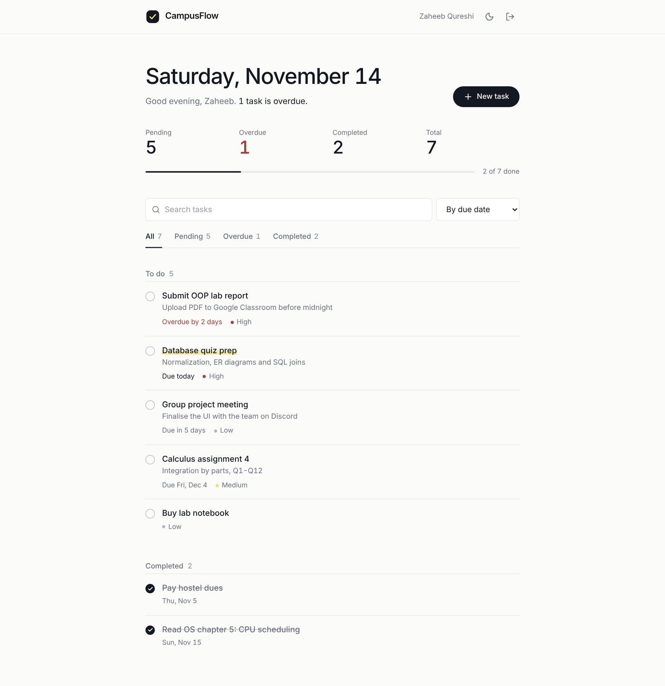
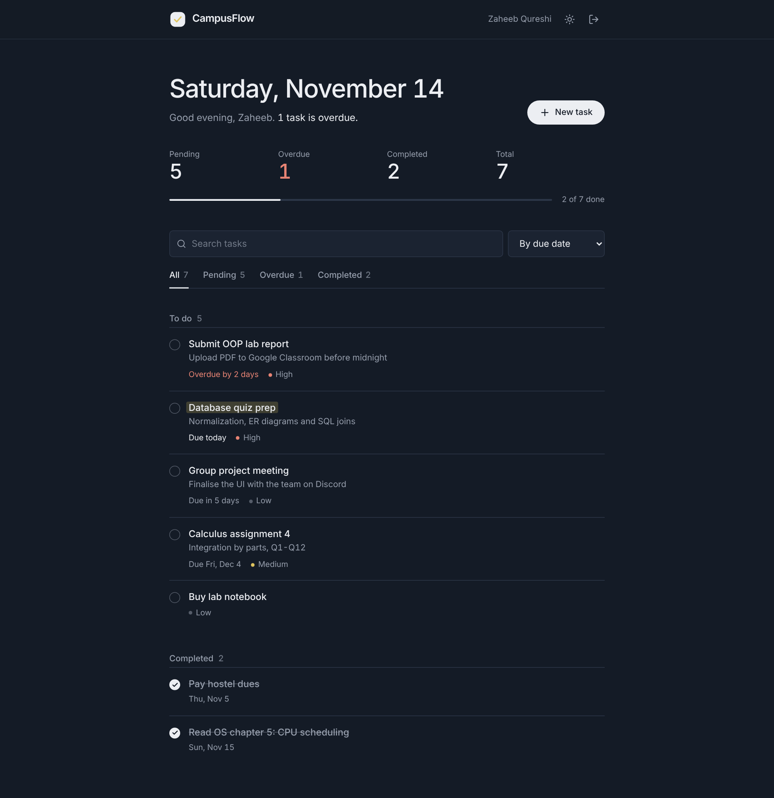
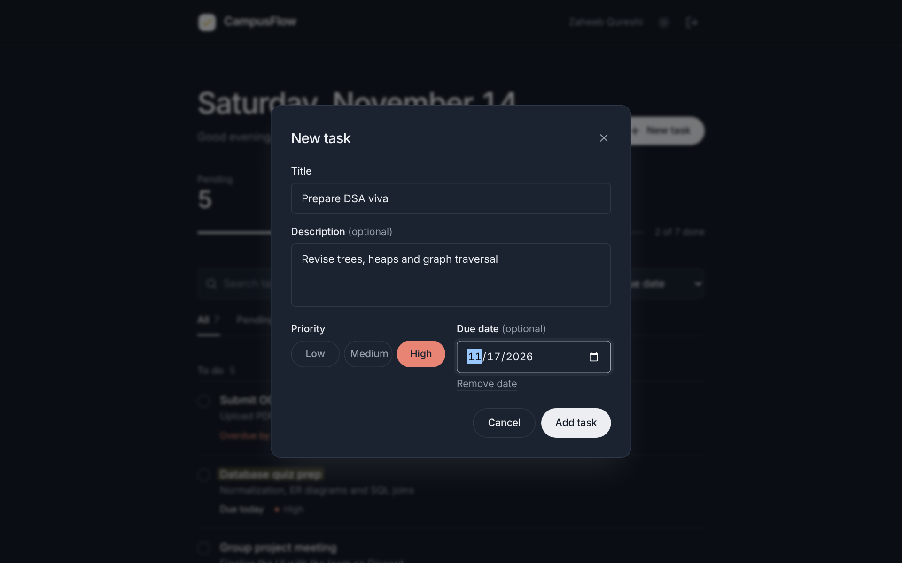
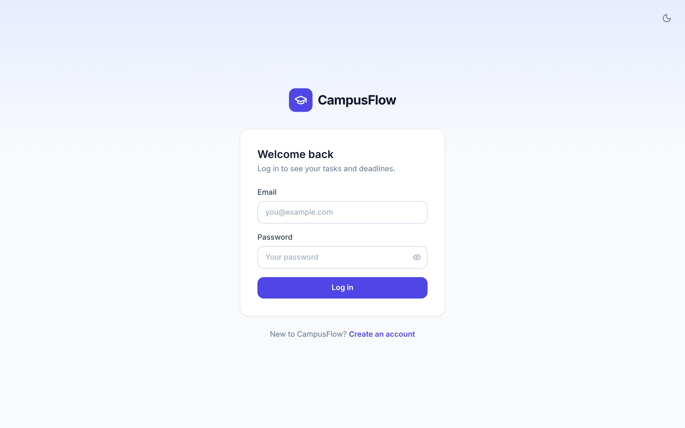
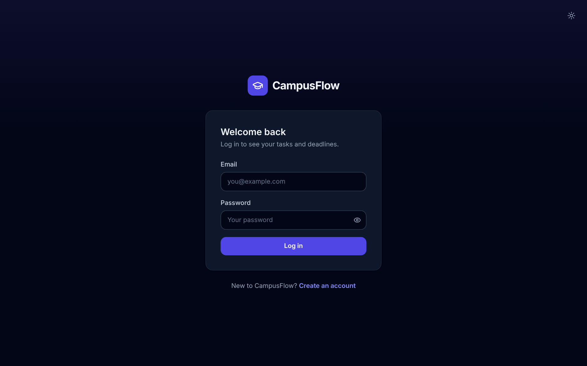
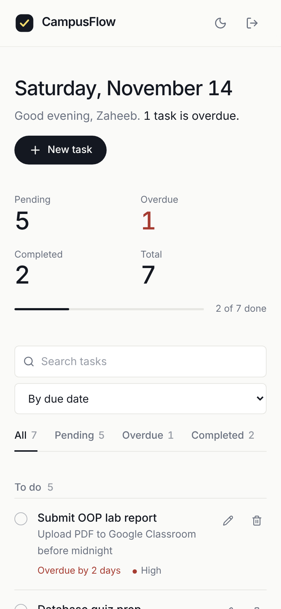
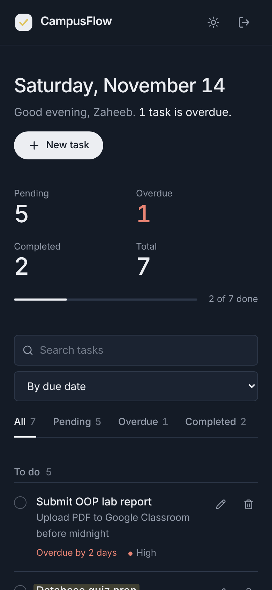

# CampusFlow

**A task manager built for students.** Track assignments, quizzes and projects, see what's due today, and never miss a deadline.

**[Live demo](https://campusflow-frontend-blond.vercel.app)** · **[Backend repo](https://github.com/Muhammad-Zaheeb/campusflow)** · **[API docs](https://campusflow-uoi7.onrender.com/docs)**

[](https://github.com/Muhammad-Zaheeb/campusflow-frontend/actions/workflows/ci.yml)
[](https://github.com/Muhammad-Zaheeb/campusflow/actions/workflows/tests.yml)




> The backend runs on Render's free tier, so the first request after a quiet period can take 30–60 seconds while the server wakes up. The app shows a notice while this happens.

---

## Features

**Tasks**
- Create, edit and delete tasks with a title, description, priority (Low / Medium / High) and optional due date
- Mark tasks done with one click; completed tasks move to their own section
- Smart due labels: *Due today*, *Due tomorrow*, *Due in 5 days*, *Overdue by 2 days*
- Overdue tasks are highlighted in red

**Finding things**
- Search across titles and descriptions
- Filter tabs: All, Pending, Overdue, Completed (each with a live count)
- Sort by due date, priority or newest

**Dashboard**
- Personal greeting and a one-line summary of what needs attention
- Stat cards (total, pending, completed, overdue) and an overall progress bar

**Experience**
- Light and dark mode: follows your system setting and remembers your choice
- Fully responsive, from a 320px phone to a large monitor, with 44px tap targets on mobile
- Add/edit in a modal, confirm before deleting, toast notifications, loading skeletons and empty states
- Keyboard shortcut: press **N** to add a task

**Accounts and security**
- Register and log in with JWT authentication
- Passwords hashed with bcrypt; input validated on both client and server
- Each user can only see and change their own tasks

**Quality**
- 30 backend tests (pytest) and lint, type-check and build checks on every push, all run by GitHub Actions

## Screenshots

| Dark mode | New task |
|---|---|
|  |  |

| Login (light) | Login (dark) |
|---|---|
|  |  |

<p align="center">
  
  &nbsp;&nbsp;
  
</p>

## How it works

```
┌────────────────────────┐   HTTPS + JWT   ┌────────────────────────┐   SQLAlchemy   ┌──────────────┐
│  React + TypeScript    │ ──────────────► │  FastAPI (Python)      │ ─────────────► │  PostgreSQL  │
│  Vite, Tailwind CSS    │ ◄────────────── │  Pydantic validation   │                │  (Neon)      │
│  hosted on Vercel      │      JSON       │  hosted on Render      │                │              │
└────────────────────────┘                 └────────────────────────┘                └──────────────┘
```

1. The user logs in; the API checks the bcrypt password hash and returns a signed JWT.
2. The frontend stores the token and sends it with every request (an Axios interceptor adds the header).
3. Every task route on the backend reads the user from the token, so queries only ever return that user's tasks.
4. If the token expires, the app sends the user back to the login page.

## Tech stack

| Area | Tools |
|---|---|
| Frontend | React 19, TypeScript, Vite, Tailwind CSS, React Router, Axios, lucide-react, react-hot-toast |
| Backend | FastAPI, SQLAlchemy 2.0, Pydantic, python-jose (JWT), passlib/bcrypt |
| Database | PostgreSQL on Neon |
| Hosting | Vercel (frontend), Render (backend) |

## Project structure

```
src/
├── api/axios.ts          # Axios instance: base URL, auth header, session-expiry handling
├── components/           # UI building blocks (TaskCard, TaskFormModal, Toolbar, StatsCards, Navbar…)
├── hooks/useTheme.ts     # Light/dark mode
├── pages/                # Login, Register, Dashboard
├── services/             # API calls for auth and tasks
├── utils/                # Date helpers (due labels, overdue checks) and error messages
├── types.ts              # Shared TypeScript types
└── App.tsx               # Routes and auth guards
```

## Run it locally

You need Node.js 20+ and the [backend](https://github.com/Muhammad-Zaheeb/campusflow) running on port 8000.

```bash
git clone https://github.com/Muhammad-Zaheeb/campusflow-frontend.git
cd campusflow-frontend
npm install
cp .env.example .env.local   # points the app at http://localhost:8000
npm run dev                  # opens on http://localhost:5173
```

Without a `.env.local`, the app uses the live API on Render.

| Command | What it does |
|---|---|
| `npm run dev` | Start the dev server |
| `npm run build` | Type-check and build for production |
| `npm run lint` | Run ESLint |
| `npm run preview` | Preview the production build |

## Roadmap

- Frontend tests (React Testing Library)
- Docker setup for the whole stack
- Course/subject tags for tasks
- Calendar view
- Password reset and email verification

## Author

**Muhammad Zaheeb**, BSCS student at FAST-NUCES
[GitHub](https://github.com/Muhammad-Zaheeb) · [LinkedIn](https://www.linkedin.com/in/zaheeb-qureshi-22814b190/)
